<p align="center"></p>

<p align="center">
  <a href="https://github.com/iAbadia/idrive-games/actions/workflows/test.yml"></a>
  
  <a href="LICENSE"></a>
</p>

Games for BMW iDrive, built around the rotary controller and an OEM-inspired dark interface. Installed and updated through the [mgu Store](https://github.com/robertnisipeanu/mgu-store).

## M Arcade

[**M Arcade**](apps/iabadia_m_arcade) brings all six games into one installed app, with a controller-driven library, shared menus, saved progress and named records. Available on the `feature/m-arcade` branch while the existing standalone releases remain available.


Run `npm run preview:arcade` to try the combined app at [localhost:2055](http://127.0.0.1:2055/). See the [architecture](docs/architecture/M_ARCADE.md) for adding games and the [save importer](apps/iabadia_m_arcade#import-existing-saves) for transferring existing progress.

## Games

<table>
<tr>
<td width="50%" valign="top">
<h3> <a href="apps/iabadia_2048">2048</a></h3>
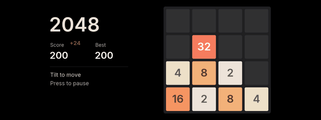
<p>Slide, merge and chase 2048. Animated tiles and an arcade top five with three-letter names.</p>
<a href="apps/iabadia_2048/preview/game.png">Full-size screenshot</a> · <a href="apps/iabadia_2048#controls">Controls</a>
</td>
<td width="50%" valign="top">
<h3> <a href="apps/iabadia_minesweeper">Minesweeper</a></h3>
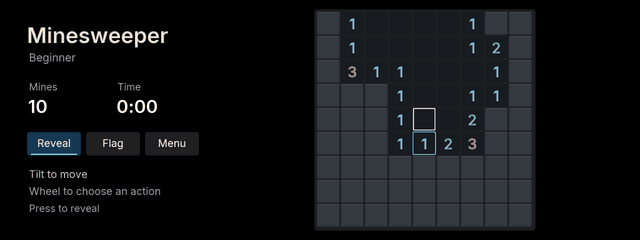
<p>Reveal safe cells and flag the mines. Three difficulties, saved progress and named best times.</p>
<a href="apps/iabadia_minesweeper/preview/game.png">Full-size screenshot</a> · <a href="apps/iabadia_minesweeper#controls">Controls</a>
</td>
</tr>
<tr>
<td width="50%" valign="top">
<h3>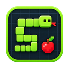 <a href="apps/iabadia_snake">Snake</a></h3>
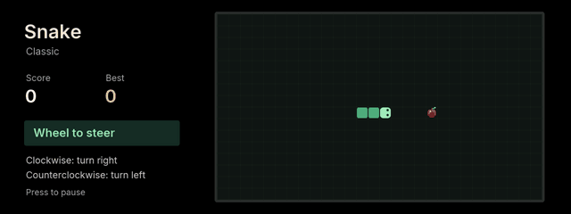
<p>Steer with the wheel and grow with every apple. Three speeds and named high scores.</p>
<a href="apps/iabadia_snake/preview/game.png">Full-size screenshot</a> · <a href="apps/iabadia_snake#controls">Controls</a>
</td>
<td width="50%" valign="top">
<h3>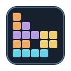 <a href="apps/iabadia_tetris">Tetris</a></h3>
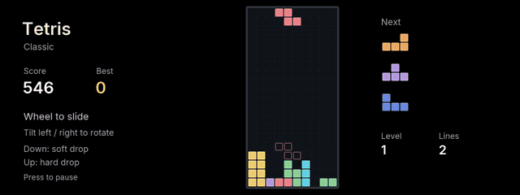
<p>Stack, rotate and clear lines. Ghost landing, next-piece previews and named high scores.</p>
<a href="apps/iabadia_tetris/preview/game.png">Full-size screenshot</a> · <a href="apps/iabadia_tetris#controls">Controls</a>
</td>
</tr>
<tr>
<td width="50%" valign="top">
<h3> <a href="apps/iabadia_invaders">Space Invaders</a></h3>
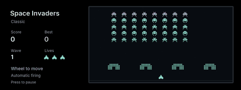
<p>Defend Earth with wheel movement, automatic firing, destructible shields and increasingly fast waves. Three difficulties and named high scores.</p>
<a href="apps/iabadia_invaders/preview/game.png">Full-size screenshot</a> · <a href="apps/iabadia_invaders#controls">Controls</a>
</td>
<td width="50%" valign="top">
<h3>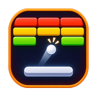 <a href="apps/iabadia_breakout">Breakout</a></h3>
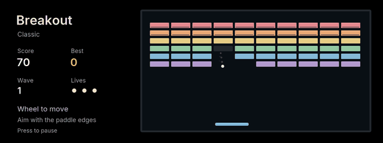
<p>Aim the ball with the paddle edges and clear tougher brick walls. Three difficulties, saved progress and named high scores.</p>
<a href="apps/iabadia_breakout/preview/game.png">Full-size screenshot</a> · <a href="apps/iabadia_breakout#controls">Controls</a>
</td>
</tr>
</table>

<sub>Short gameplay loops rendered from each game’s own drawing code. All games save progress and use wheel or up/down navigation in their pause menus.</sub>

<details>
<summary>View all screenshots</summary>

### 2048


### Minesweeper

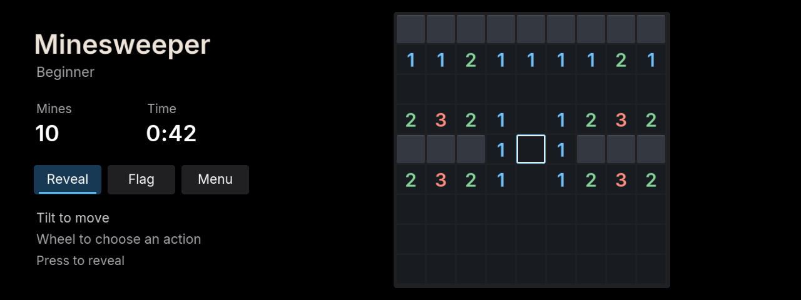

### Snake

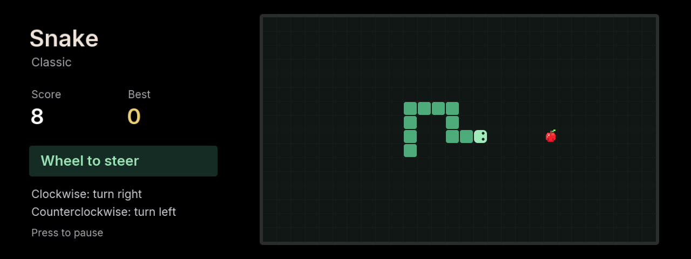

### Tetris

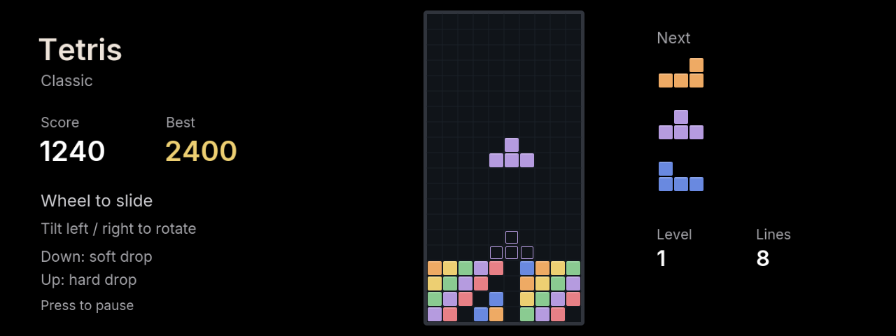

### Space Invaders

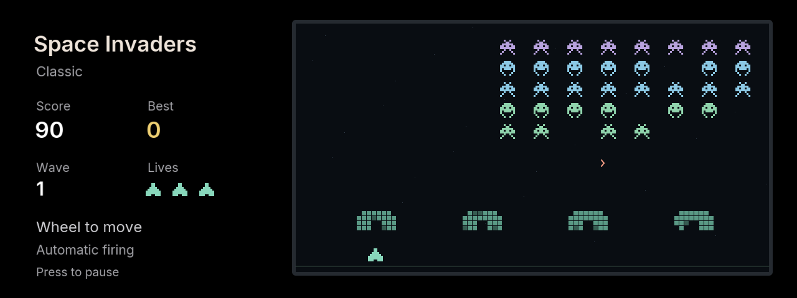

### Breakout

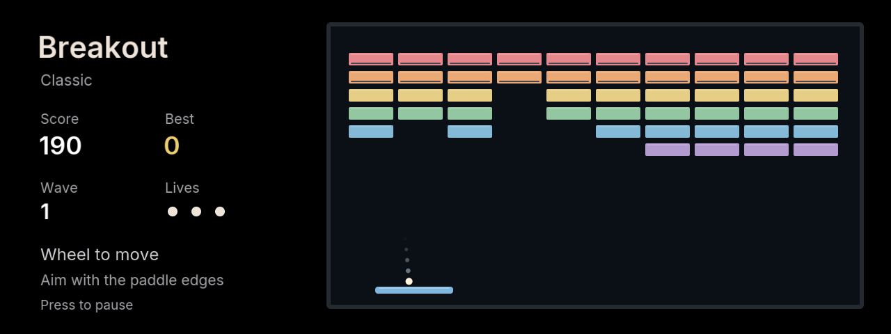

</details>

## Install

Add `iAbadia/idrive-games` in **Store → Settings → Add source**, choose the **main** branch, then install a game. Keep the existing mgu-store source enabled for the shared renderer. Games run locally on the head unit.

## Controls

| Game | Play |
| --- | --- |
| 2048 | Tilt to slide the tiles |
| Minesweeper | Tilt to move; wheel to choose Reveal, Flag or Menu; press to act |
| Snake | Wheel clockwise to turn right; counterclockwise to turn left |
| Space Invaders | Wheel or left/right tilt to move; automatic firing; press to pause |
| Breakout | Wheel or left/right tilt to move the paddle; press to pause |
| Tetris | Wheel to slide; left/right tilt to rotate; down/up for soft/hard drop |

Press to pause in 2048, Snake, Tetris, Space Invaders and Breakout. Every pause menu supports the wheel or up/down, with center to confirm.

## Development

Node.js 22+ and Git. No npm dependencies are required.

```sh
npm test
npm run build
npm run preview
```

The default preview opens M Arcade at `http://127.0.0.1:2055`. The original 2048 preview is available through `npm run preview:2048`. See the [development notes](docs/DEVELOPMENT.md) for all previews, [media guide](docs/media) to regenerate the gallery, and [release guide](release) for packaging.

## Credits & license

GPL-3.0-or-later. Built on [mgu-store](https://github.com/robertnisipeanu/mgu-store) and the community [idrive7-apps](https://github.com/cauliflowermossgrape/idrive7-apps) drawing kit. Bundled MIT and font licenses are retained; see [THIRD_PARTY.md](THIRD_PARTY.md). No BMW SDK or firmware files are distributed. This is an independent community project, not affiliated with BMW.
