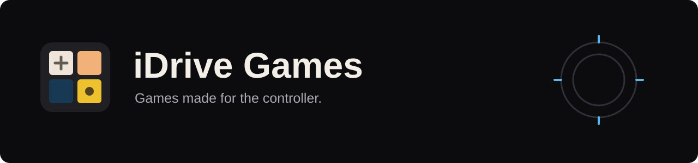

<p align="center"></p>

<p align="center">
  <a href="https://github.com/iAbadia/idrive-games/actions/workflows/test.yml"></a>
  
  <a href="LICENSE"></a>
</p>

Games for BMW iDrive, built around the rotary controller and an OEM-inspired dark interface. Installed and updated through the [mgu Store](https://github.com/robertnisipeanu/mgu-store).

## Games

| Game | Features | Platform |
| --- | --- | --- |
| [2048](apps/iabadia_2048) | Animated tiles, rotary menus, saved progress and an arcade top five with three-letter initials | iDrive 7 |
| [Minesweeper](apps/iabadia_minesweeper) | Three difficulties, safe first reveals, flags, saved games and best times | iDrive 7 |


## Install

Add `iAbadia/idrive-games` in **Store → Settings → Add source**, choose the **main** branch, then install a game. Keep the existing mgu-store source enabled for the renderer dependency. The head unit links each game against its own SDK. Published versions can also be installed through **Releases** when available.

## Controls

**2048:** tilt to move; press to pause. **Minesweeper:** tilt to move the cursor; use the wheel to choose Reveal, Flag or Menu, then press. Both games use wheel or up/down for menu navigation.

## Development

Node.js 22+ and Git. No npm dependencies are required.

```sh
npm test
npm run build
npm run preview
```

The desktop preview opens at `http://127.0.0.1:2048`. See the [2048 guide](apps/iabadia_2048) for keyboard controls and the [release guide](release) for packaging.

## Credits & license

GPL-3.0-or-later. Built on [mgu-store](https://github.com/robertnisipeanu/mgu-store) and the community [idrive7-apps](https://github.com/cauliflowermossgrape/idrive7-apps) drawing kit. Bundled MIT and font licenses are retained; see [THIRD_PARTY.md](THIRD_PARTY.md). No BMW SDK or firmware files are distributed. This is an independent community project, not affiliated with BMW.
