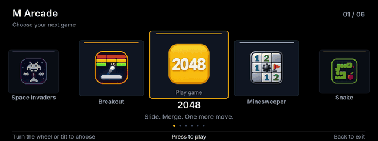
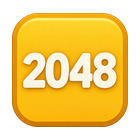
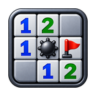
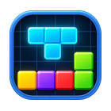

<p align="center"></p>

<p align="center">
  <a href="https://github.com/iAbadia/idrive-games/actions/workflows/test.yml"></a>
  
  <a href="LICENSE"></a>
</p>

**M Arcade** brings six classic games to BMW iDrive in one controller-first app, with an OEM-inspired dark interface, an animated game carousel and shared menus, progress and named records.



## Included games

| Game | Play | Records |
| --- | --- | --- |
|  **2048** | Tilt to slide and merge tiles | Top five scores |
|  **Minesweeper** | Tilt to move; wheel selects Reveal, Flag or Menu | Best winning time per difficulty |
|  **Snake** | Wheel clockwise turns right; counterclockwise turns left | Best score per speed |
|  **Tetris** | Wheel to slide; tilt to rotate or drop | Best score per speed |
|  **Space Invaders** | Wheel or left/right tilt to move; automatic firing | Best score per difficulty |
|  **Breakout** | Wheel or left/right tilt to move; paddle edges aim the ball | Best score per difficulty |

Every game saves progress. Records use three-letter initials. See the [app page](apps/iabadia_m_arcade) for controls, screenshots and importing existing saves.

## Install

Add `iAbadia/idrive-games` in **Store → Settings → Add source**, choose **feature/m-arcade**, then install **M Arcade**. This branch exposes one app containing all six games. Keep the existing mgu-store source enabled for the shared renderer. Games run locally on the head unit.

## Controls

Turn the wheel or tilt to browse the carousel; press center to open a game. Center pauses during play, except in Minesweeper where it performs the selected action and Menu is selected with the wheel. Shared menus support wheel or up/down navigation and center to confirm. Native Back returns through the menus to the game library, then exits M Arcade.

## Development

Node.js 22+ and Git. No runtime npm dependencies are required.

```sh
npm test
npm run build
npm run size
npm run preview
```

The preview opens at [localhost:2055](http://127.0.0.1:2055/). New game development belongs in `apps/iabadia_m_arcade/src/games/`; see the [architecture and adding-game guide](docs/architecture/M_ARCADE.md), [development notes](docs/DEVELOPMENT.md) and [release guide](release).

The [legacy standalone sources](docs/LEGACY_GAMES.md) remain for migration and regression reference. They are frozen and excluded from this branch's Store manifest and release targets. Existing installations and saved data are not removed automatically.

## Credits & license

GPL-3.0-or-later. Built on [mgu-store](https://github.com/robertnisipeanu/mgu-store) and the community [idrive7-apps](https://github.com/cauliflowermossgrape/idrive7-apps) drawing kit. Bundled MIT and font licenses are retained; see [THIRD_PARTY.md](THIRD_PARTY.md). No BMW SDK or firmware files are distributed. This is an independent community project, not affiliated with BMW.
