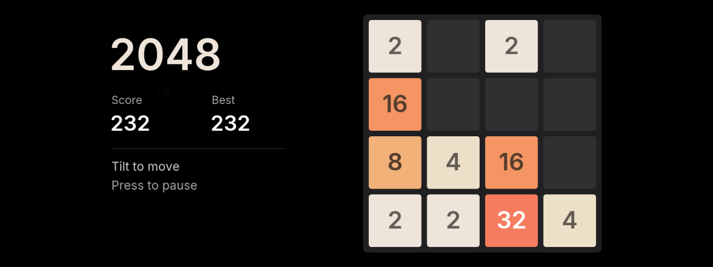
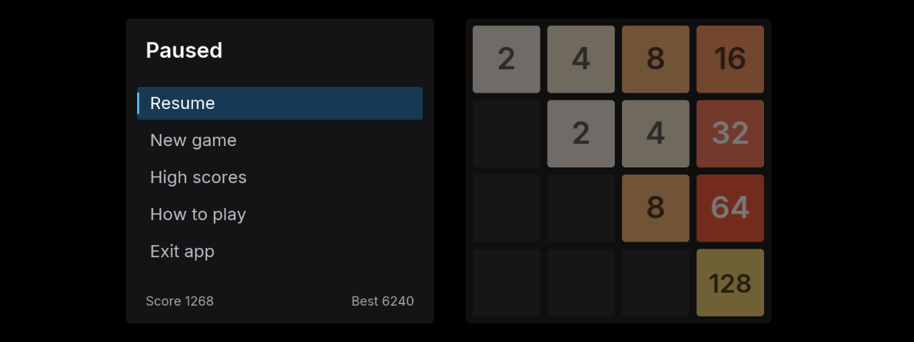

# 2048

Classic 4×4 2048 on the iDrive 7 main screen. Warm cream, orange and gold
tiles sit on a charcoal board, with a black background and blue menu focus.
Tiles slide for 120 ms, then merged tiles briefly expand and settle while
the new tile appears. The transition lasts 260 ms in total. Further moves
take effect immediately; pausing or losing focus settles the board.

## Controls

- Tilt the controller left, right, up or down to move. A held tilt makes one move.
- Press the center button to pause and open the menu.
- Turn the wheel or tilt up/down to choose an item; press to select it.
- The side menu keeps the dimmed board visible and has **Resume**, **New game**,
  **High scores**, **How to play** and **Exit app**. Resume is selected first. Wheel focus
  slides between rows; selecting an item gives a brief visual response.
  A new game requires confirmation, with Cancel selected first.
- BACK returns from Help or confirmation to the menu, then resumes the game.
  The head unit uses nested HMI states for this navigation.
- Merges show the gained score as a floating, fading increment.
- Reach 2048 to choose **Keep playing**. A blocked board opens **Game over**.
- Every valid move saves the board, score and best score. Leaving the app or
  losing HMI focus saves and pauses; returning shows the pause menu.
- The local arcade table keeps the top five scores with three-letter initials.
  A qualifying game-over score opens initials entry. **High scores** also
  offers **Save current score** for a qualifying run. Saving an improved
  score from the same run updates its entry. Starting a new game keeps the table.
- In initials entry, the wheel or up/down cycles A–Z, left/right moves the
  cursor, and center confirms a letter and advances. Confirming the third
  letter saves. BACK cancels. An unfinished name and cursor survive app restarts.

Progress, the arcade table and initials drafts share the atomic app-data
save (`data/2048.json`). Existing saves without an arcade table load normally.
A failed score write keeps the initials editor open for retry.

The Store installs the source package and links it to the head unit's own
OAP SDK. Requires `mgu-render` 0.6.9 with its HMI controller gate active.
Without controller support, the app displays an update message and does not
grab input. BACK and MENU remain HMI controls. No network access is needed.

## Development

```sh
node apps/iabadia_2048/tools/test.js
node apps/iabadia_2048/tools/test_app.js
node apps/iabadia_2048/tools/preview.js
node apps/iabadia_2048/tools/build.js
node apps/iabadia_2048/tools/serve.js
```

The desktop preview is at `http://127.0.0.1:2048`. Arrow keys simulate tilts,
Enter the center button, and the mouse wheel or `[` / `]` the dial. Its PNG
frames use the app's drawing code, fonts, game and menu state machine.
Desktop preview saves are separate from the car's data.




The drawing kit and renderer client are adapted from mgu-store and the
community idrive7-apps kit (MIT; `LICENSE-kit.txt`). Inter glyph atlases
are SIL OFL 1.1 (`LICENSE-Inter.txt`). FrontCCU direction ordinals are
documented in the upstream [Doom controls](https://github.com/cauliflowermossgrape/idrive7-apps/blob/main/apps/doom/controls.js).
