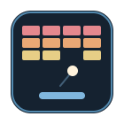
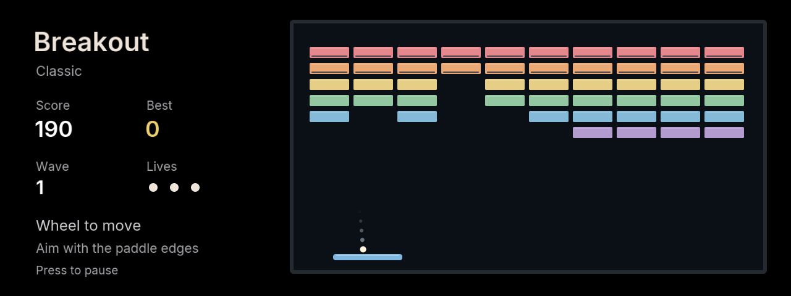

# Breakout

Clear brick walls with a ball and paddle on BMW iDrive 7. Aim rebounds with the paddle edges and survive increasingly fast waves.

## Controls

| Control | Action |
| --- | --- |
| Wheel clockwise / counterclockwise | Move paddle right / left |
| Tilt left / right | Move paddle left / right |
| Center / Back | Pause |
| Wheel or up/down in menus | Select an option |
| Center in menus | Confirm |

Turn the wheel to start. The ball launches automatically after a short delay, including after a lost life. You have three lives. Upper brick rows take two hits, and clearing a wall advances the wave and awards 200 bonus points. Paddle-edge hits aim the ball at a steeper angle.

Relaxed, Classic and Fast vary paddle width and ball speed. Each keeps one best score with three-letter initials. The game saves the ball trajectory, brick damage, paddle, remaining lives and records on brick hits, life changes, pause, hide and exit. Reloads open paused. Name entry uses wheel/up/down for letters, left/right for the cursor and center to confirm.

## Development

`npm run preview:breakout` serves http://127.0.0.1:2054. Wheel or `[` / `]` moves the paddle, left/right arrows also move, Enter pauses and Escape goes back. Run `npm test`, `npm run build` and `npm run size` from the repository root.

Uses the shared renderer and the head unit's own SDK. Game rules and launcher art are original code; no external game engine, ROM or commercial artwork is bundled. This is an independent community implementation.
