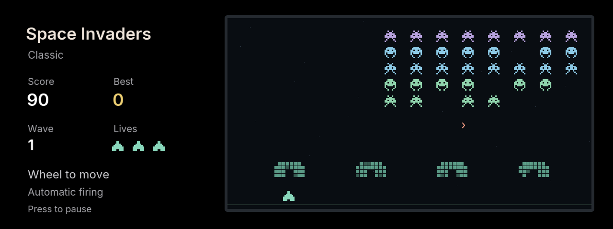

> **Legacy standalone implementation.** This branch distributes the game through [M Arcade](../iabadia_m_arcade). This source is retained for regression tests and save migration; new development belongs in M Arcade.

# Space Invaders

Defend Earth from descending alien formations on BMW iDrive 7. Move between shots, use the shields and clear increasingly fast waves.

## Controls

| Control | Action |
| --- | --- |
| Wheel clockwise / counterclockwise | Move ship right / left |
| Tilt left / right | Move ship left / right |
| Center / Back | Pause |
| Wheel or up/down in menus | Select |
| Center in menus | Confirm |

Turn the wheel to start. Your ship fires automatically, leaving center available for pause. Three hits end the game; a brief invulnerability period follows a hit. Shields absorb both friendly and enemy shots and are rebuilt each wave. Aliens reaching the defense line end the game immediately.

Choose Relaxed, Classic or Fast. Each difficulty keeps one best score with a three-letter name. Progress, bullets, shield damage, lives and records are saved on combat changes, pause, hide and exit. Reloaded games open paused. Name entry uses wheel/up/down to change a letter, left/right to select a position, and center to confirm.

## Development

`npm run preview:invaders` serves http://127.0.0.1:2053. Wheel or `[` / `]` moves the ship, left/right arrows also move, Enter pauses, Escape goes back. Run `npm test`, `npm run build` and `npm run size` from the repository root.

Uses the shared mgu-render dependency and the head unit's own SDK. Original code-drawn sprites; no downloaded game engine, ROM or commercial artwork. This is an independent community game, not affiliated with the original game's publisher.
