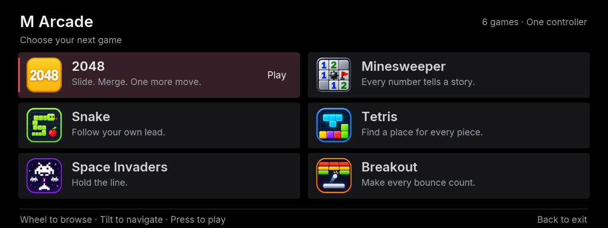

<p align="center"></p>
<h1 align="center">M Arcade</h1>
<p align="center">Six classics. One app. Built for the iDrive controller.</p>



2048, Minesweeper, Snake, Tetris, Space Invaders and Breakout share one game library, pause menu and record system. Each game keeps its progress when you return to the library. 2048 keeps an arcade top five; the other games keep one named record per difficulty, with fastest winning times for Minesweeper.

## Controls

| Screen | Controls |
| --- | --- |
| Library | Wheel to browse, tilt to navigate, center to open |
| Menus | Wheel or up/down to select; center to confirm |
| Gameplay | Original game controls; center to pause |
| Minesweeper | Center performs Reveal/Flag; wheel selects actions including Menu |
| Name entry | Wheel/up/down changes letter; left/right moves cursor; center confirms each letter |

Native Back returns from a game to the library, from a pause menu to the game, and from the library out of M Arcade. Each game includes How to play and Records.

## Install and preview

In the Store, add `iAbadia/idrive-games`, select branch `feature/m-arcade` and install **M Arcade**. Keep the mgu-store source enabled for Renderer 0.6.9 or newer. One M Arcade installation contains every game; the standalone entries remain available during migration.

For the desktop preview, run `npm run preview:arcade` at the repository root and open [localhost:2055](http://127.0.0.1:2055/). It uses the same models, input router and board/menu drawings as the native app.

## Import existing saves

Old standalone apps keep their own data. Export their JSON files through your existing authorized car/deployment access, then prepare a separate output folder:

```sh
node apps/iabadia_m_arcade/tools/import_saves.js --source exported-saves --output imported-m-arcade
```

Recognized names: `2048.json`, `Minesweeper.json`, `Snake.json`, `Tetris.json`, `Invaders.json`, `Breakout.json`. The importer validates input, preserves boards/records/unfinished 2048 initials, leaves exports untouched and skips existing destination saves. Unnamed historical records display `---`.

With M Arcade stopped, transfer the generated `games/` files into its own `data/m-arcade/` directory using the supported deployment/file-transfer mechanism and the app's ownership/permissions. Keep a backup and do not overwrite newer M Arcade saves. Automatic Store transfer is not provided. Keep the standalone saves until the imported progress and records have been verified in the car.

## Development

See [the architecture and adding-game guide](../../docs/architecture/M_ARCADE.md). Canonical code lives in `src/`; `tools/build.js` generates flat `package-src/` aliases for the head unit linker. Run `npm test`, `npm run build` and `npm run size` from the repository root. No runtime npm dependencies or BMW SDK files are bundled.
