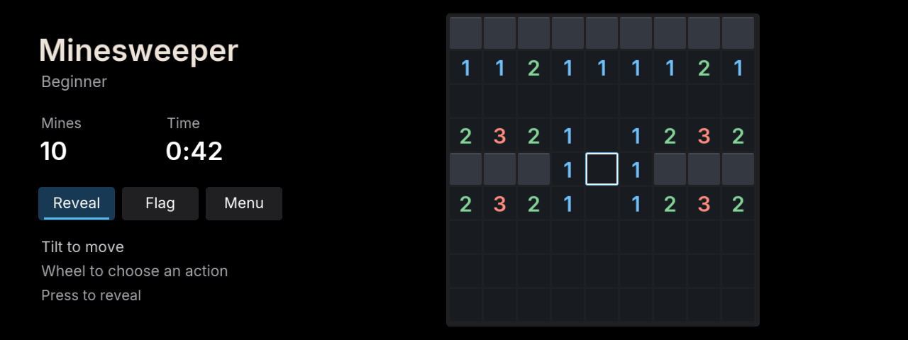

> **Legacy standalone implementation.** This branch distributes the game through [M Arcade](../iabadia_m_arcade). This source is retained for regression tests and save migration; new development belongs in M Arcade.

<p></p>

# Minesweeper

Classic Minesweeper for iDrive 7, with a dark interface and controller input.



## Controls

- Tilt left/right/up/down to move the blue cursor.
- Turn the wheel to choose **Reveal**, **Flag** or **Menu**, then press center.
- In menus, wheel or up/down changes the selection; center selects it.
- Press a revealed number to chord its neighbors when the adjacent flag count matches.
- BACK returns through menus; leaving the app saves and pauses the game.

The first reveal and its neighbors are safe. Revealing all safe cells wins;
revealing a mine ends the game. Flags protect cells from reveals. Incorrect
flags can expose a mine when chording.

## Difficulties

| Level | Board | Mines |
| --- | --- | --- |
| Beginner | 9 × 9 | 10 |
| Intermediate | 16 × 16 | 40 |
| Expert | 30 × 16 | 99 |

The board, flags, cursor and elapsed time persist in the app's data folder.
One best completion time and three-letter name are kept for each difficulty. A new fastest win opens initials entry: wheel or up/down changes a letter, center confirms and advances, and left/right moves the cursor. Confirming the third letter saves the name. Older records retain their times and show `---` until replaced. The clock
starts on the first reveal and pauses while menus are open or the app is hidden.
New game and difficulty changes require confirmation, with Cancel selected first.

## Development

```sh
npm run preview:minesweeper
node apps/iabadia_minesweeper/tools/test.js
node apps/iabadia_minesweeper/tools/test_app.js
```

The desktop preview is at `http://127.0.0.1:2050`. Arrow keys move, Enter
presses center, `[` / `]` or the mouse wheel selects the action, and Escape
opens the pause menu. Preview saves are separate from the car's data.

Requires `mgu-render` 0.6.9 and its controller gate. Installed through the
Store from the repository's main branch. The 140×140 launcher icon matches
the iDrive app grid. Source packages contain no BMW SDK or built app bundle.

MIT drawing-kit and Inter font licenses are retained in the staged app tree;
see the repository's [third-party notices](../../THIRD_PARTY.md).

The source package is approximately 134 KiB. It contains only the font atlas sizes the game uses; see [size measurements](../../docs/APP_SIZES.md).
