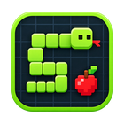
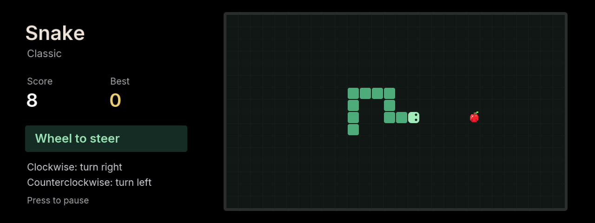

> **Legacy standalone implementation.** This branch distributes the game through [M Arcade](../iabadia_m_arcade). This source is retained for regression tests and save migration; new development belongs in M Arcade.

# Snake

Classic Snake for BMW iDrive 7. Eat red apples, grow your snake, and avoid walls and your own tail.

## Controls

| Control | Action |
| --- | --- |
| Wheel clockwise | Turn the head 90° right |
| Wheel counterclockwise | Turn the head 90° left |
| Tilt | Steer in an absolute direction |
| Center / Back | Pause |
| Wheel or up/down in menus | Select an option |
| Center in menus | Confirm |

Turn the wheel to start. Two turns can be queued; opposite-direction tilt is ignored. Choose Relaxed, Classic or Fast in the pause menu. Progress is saved on eating food, pausing, hiding or exiting; restored games open paused. Each speed keeps one best score with three-letter initials. In name entry, wheel/up/down changes a letter, center confirms, and left/right moves between letters.

## Preview and build

From the repository root: `npm run preview:snake` (http://127.0.0.1:2051). Keyboard: `[` turns left, `]` turns right, Enter pauses, Escape goes back. `npm test`, `npm run build`, and `npm run size` cover all games.

Uses the shared mgu-render dependency and the head unit's SDK. No npm runtime dependencies or BMW SDK binaries are shipped.
