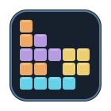
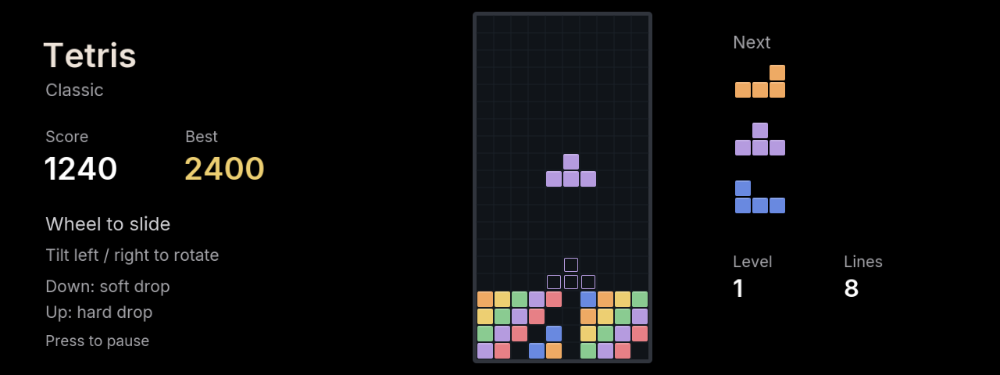

# Tetris

A falling-block game for BMW iDrive 7 / 8. Fill horizontal rows to clear them and keep the stack from reaching the top.

## Controls

| Control | Action |
| --- | --- |
| Wheel | Move left/right |
| Tilt left / right | Rotate counterclockwise / clockwise |
| Tilt down | Soft drop one cell |
| Tilt up | Hard drop and lock |
| Center / Back | Pause |
| Wheel or up/down in menus | Select |
| Center in menus | Confirm |

Turn the wheel to start. The 10x20 board uses seven-bag randomization, a three-piece preview, a ghost landing outline, simple wall/floor kicks, and a 500ms lock delay with up to ten movement resets. These are custom rotation rules. Each ten lines increases the level. Clearing one/two/three/four lines earns 100/300/500/800 times the level; soft and hard drops add one and two points per cell.

Choose Relaxed, Classic or Fast starting speed. Each keeps one best score and three-letter initials. Games save when a piece locks, on pause, hide or exit, and reopen paused. Names use the same wheel/arrow/center entry as the other games.

## Development

`npm run preview:tetris` opens the desktop preview at http://127.0.0.1:2052. Use `[` / `]` or the wheel to slide, arrow keys to rotate/drop, Enter to pause, Escape to go back. Run `npm test`, `npm run build`, `npm run size` from the repository root.

Uses the shared renderer and the head unit's own SDK. No runtime npm dependencies. Independent community implementation, not affiliated with The Tetris Company.

ID8 uses layer rendering and the same controller mapping. See [platform notes](../../docs/IDRIVE8.md) for the input assumption and local validation.
