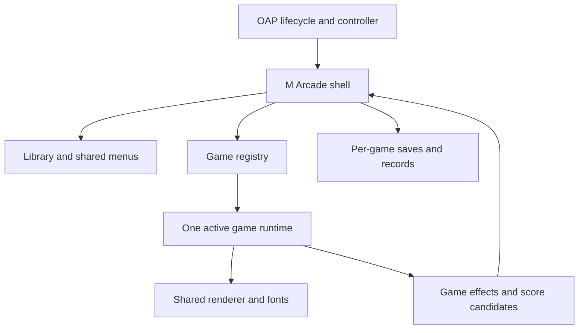

# M Arcade architecture proposal

Status: design on `feature/m-arcade`. The six released ID7 apps remain unchanged. This proposal consolidates them into one installed app, one renderer connection, one shared UI and a registry of isolated game modules. ID8 work remains on its separate feature branch; ID7 is the first integration target.

## Decisions

- One OAP identity and Store entry: `iabadia_m_arcade`, display name **M Arcade**.
- One library, input router, clock, native navigation stack, menu system, score service, save repository, font set and renderer client.
- One active game runtime. Returning to the library saves and disposes it; re-entering reconstructs it from its save. Inactive games have no running timers, input handlers or renderer connections.
- Statically bundled game modules registered at build time. No downloadable executable plugins, webviews, per-game OAP apps or runtime dependency installation.
- Preserve game-specific rules, controls and ranking policies. Shared menus do not mean forcing identical gameplay or identical leaderboards.
- Refactor in stages; keep standalone packages available until state migration and the unified app are validated.

## Package layout

```text
apps/iabadia_m_arcade/
  mgu-app.json / release.json / assets/icon.png
  <id>@<version>/             one staged OAP app and native RHMI resources
  src/
    app.js                    SDK lifecycle and foreground ownership
    core/
      host.js                 renderer capabilities and viewport placement
      router.js               library/game/pause/detail routes
      input.js                normalize CCU once; dispatch to current route
      loop.js                 one clock and frame scheduler
      saves.js                atomic, versioned per-game envelopes
      scores.js               ranked records and run identity
      registry.js             game IDs, metadata, static loaders
    ui/
      library.js              six game cards, selection and resume indication
      menu.js / initials.js   shared focus, actions and letter entry
      dialogs.js / chrome.js  confirmations, status and common score rail
      theme.js / fonts/       one token set and atlas set
    games/
      2048/                   model.js, runtime.js, board.js, definition.js
      minesweeper/
      snake/
      tetris/
      invaders/
      breakout/
    kit/                      one drawing/PNG/image/font transport implementation
  tools/build.js              module namespacing, asset validation, source packaging
  tools/serve.js               one desktop preview with the real shell and games
```

Game modules depend on the shared contract and drawing primitives. The shell depends on the registry and contract, not on individual game rules. Native SDK, filesystem, renderer transport and application navigation belong to the shell only.



## Registry and game contract

See [the interface draft](game-contract.d.ts). A registry entry declares a stable ID, title, module/state versions, icon, available modes, controls, timing cap, leaderboard policies and a static loader. The runtime owns game rules and board-specific animation; the shell owns menus, persistence, clock delivery and global navigation.

The practical minimum is `input`, `update`, `render`, `phase`, `snapshot` and `dispose`, plus module-level state validation/migration. `hud()` supplies labelled values for the shared status rail; `scoreCandidate()` supplies an eligible current record when Save score is chosen before a run ends. Neither exposes mutable game state to the shell. Modules may reuse their existing pure `game.js` models through adapters. Rendering must not advance game state: current renderers call `session.advance()` inside `draw()`, so that side effect must be removed during extraction. Updates run once, from the shell clock.

A step returns effects such as dirty frame, checkpoint request, completion, score candidate or continue availability. It does not write files or navigate native screens. `snapshot()` excludes trails, frame caches and uncommitted animation bookkeeping; it retains gameplay-essential velocity, countdowns, board damage and progress.

Use an injected monotonic game clock that excludes paused time, and an injected random source. A discrete game such as 2048 has no gravity timer but can request frames while tiles animate. Timed games receive bounded deltas, keep their existing physics substeps, and never catch up across a pause. Resume resets the loop baseline. The shell pauses delivery before taking a suspend snapshot.

## Input and navigation

Normalize raw controller events once, including named/numeric values, wheel-counter wraparound, invalid samples and held short-to-long input suppression. Reset the baseline on focus change or source handover. A route owns input exclusively: a menu turn cannot also move the paddle behind it.

| Route | Wheel | Center | Tilt | Native Back |
| --- | --- | --- | --- | --- |
| Library | Cycle six cards | Open selected game | Navigate the two-column grid | Exit M Arcade |
| Playing | Game mapping | Pause, except Minesweeper action | Game mapping | Save/pause and return to library |
| Pause | Select option | Confirm | Up/down select | Resume game |
| Help / records / confirmation | Route-specific | Confirm | Route-specific | Return to parent |
| Initials | Change letter | Confirm/advance/save third | Left/right cursor; up/down letter | Cancel to parent |

Native Back is not assumed to be intercepted through CCU. Use four native host states matching the actual stack: **Library → Game → Pause → Detail**. Back from Game returns focus to Library, so the shell checkpoints and disposes that runtime. It must not fight the HMI by immediately reopening the popped game state. Back from Pause resumes Game, while nested details return to their parent route. Dialogs share the detail host through the logical router; verify replacement at the same depth rather than pushing indefinitely.

Minesweeper keeps center for Reveal/Flag and its wheel-selected Menu action. Its native Back returns to the library like the others. The shell consults the game's control declaration instead of hard-coding center as pause for every game.

Common pause options: **Resume**, **New game**, game-defined **Difficulty** where applicable, **Records**, **How to play**, **Back to Arcade**, **Exit M Arcade**. New game or a difficulty change confirms replacement of that game's progress only; each game keeps one in-progress run, while records for every difficulty survive replacement. Initials and confirmations remain shell routes, never game-owned modal implementations.

Opening the app always shows the library, remembering the selected card. Choosing a saved running game opens its paused state with Resume selected. Never resume timed gameplay automatically after visibility loss, a popup or reconnect. A completed save opens the appropriate end screen with New game available.

## Persistence and records

```text
data/shell.json                selected card and shared preferences
data/games/2048.json          game state + records + run identity + initials draft
data/games/minesweeper.json
data/games/snake.json
...
```

Each game envelope contains `envelopeVersion`, `gameId`, `stateVersion`, `modeId`, `runId`, `state`, `records` and `initialsDraft`. File paths come from validated registry IDs, not from arbitrary module input. Keep game state and its resulting records in the same atomic file so a completed run and its score cannot be committed independently. Shell settings are separate; one corrupted game must not invalidate the library or other games.

Use bounded JSON, per-game validators, sequential version migrations, restrictive file permissions and temp-file/fsync/rename writes. Keep one last-known-good backup for recoverable parse/validation errors. Report save failures and offer retry; do not silently discard the board or switch games after a failed checkpoint. Migration makes a backup before writing an upgraded envelope.

Use explicit checkpoints: accepted discrete moves, brick kills/line locks/life changes as appropriate, game completion, pause, leaving a game and app shutdown. Coalesce same-tick writes and serialize them per game; do not fsync every animation frame. An app-controlled transition flushes its latest checkpoint before disposing the runtime. Native Back/Home can move focus before asynchronous I/O finishes: stop simulation immediately, retain the pending snapshot, and block further game activation until the save succeeds or the user explicitly resolves the error. Shutdown is best-effort; earlier checkpoints bound progress loss if the process is killed.

| Game | Shared score-service policy |
| --- | --- |
| 2048 | Points descending, top five; a better submission from the same run updates its entry |
| Minesweeper | Winning time ascending, one entry per difficulty; losses do not qualify |
| Snake, Tetris, Space Invaders, Breakout | Points descending, one entry per difficulty |

Validate score candidates against the declared board, mode and finite non-negative integer metric before ranking. Tie handling is explicit and preserves incumbent records. Generate persistent run IDs in the shell when a new game starts. Score effects are idempotent by run ID, board ID and submitted value. Continuing after 2048 uses the same run; restarting creates a new one. Keep unfinished three-letter names with their game's envelope and return route. The UI can label time records **Best times** while using the same ranking implementation.

## Packaging constraint and solution

The existing `tools/oap_link.js` names modules using `path.basename()`, so `games/2048/model.js` and `games/tetris/model.js` collide. Import resolution also expects flat `./name.js` aliases. A nested source layout therefore needs a build adapter; simply listing nested files is not sufficient.

Keep the existing Store-compatible source-package format. Add a deterministic build-time namespacer that maps each canonical local path to a unique flat name (for example `games/2048/model.js` → `g_2048_model.js`, `core/input.js` → `c_input.js`) and rewrites static relative `require()` specifiers against that map. Emit readable generated source into the M Arcade package's module list. Treat SDK and Node builtins as external, preserve source/license headers, sort outputs and reject unresolved/dynamic imports or collisions. Commit/generate inputs so source-package and on-unit builds use the same frozen module map; never commit a linked SDK bundle.

This avoids requiring a new system linker just to install M Arcade. Test two identically named game modules in the same package, cycle detection policy, shared import identity and byte-identical repeated builds. The registry uses static loader functions, allowing require caching to load a module only when selected while leaving one active runtime.

## Reuse and size

The current six apps contain **882,956 bytes of font source**, mostly repeated. The 2048 superset contains **237,142 bytes** and covers the regular 17/23/31 and semibold 19/25/33/44/58/103 sizes used across the games. Sharing that set removes roughly 73% of font source duplication before compression. These are measured source bytes, not installed memory or a promised package size.

Share the drawing kit, transport, menu widgets and persistence service once. Game code and each final icon remain separate. Library icons are decoded/uploaded once using a bounded PNG path and reused by image ID; six decoded 140x140 RGBA icons occupy about 459 KiB before any renderer copies. Do not store high-resolution masters or duplicate font exports in individual game modules.

Retain the current **512 KiB compressed / 1 MiB unpacked source** budgets as initial acceptance targets. Measure after integration; do not claim the unified size from simple addition/subtraction of compressed packages. The source package excludes docs, GIFs, tests, generators, SDK code and user saves. Native installation still links against the head unit's own SDK.

## Migration from six installed apps

M Arcade has a new OAP identity and app-data directory. Its process must not assume it can read the six existing apps' data: their homes are owned by different app UIDs. Copying old save filenames into the new code does not migrate records.

Keep the old apps installed and their saves untouched during rollout. A complete migration needs a Store/deploy-assisted export/import path (or another platform-supported user-triggered transfer), backups and validated per-game adapters. That integration is a separate deliverable; this design does not invent an existing Store API. Restore each old state's schema and ranking policy into its corresponding new envelope, including 2048 run IDs and unfinished initials. Import is idempotent and never erases either source or destination on failure.

The library can offer **Import existing games** only once a real supported transfer exists. Retire the standalone catalog entries after migration, persistence and rollback have been verified. Do not auto-uninstall old apps or promise seamless migration before this work is implemented.

## Adding a game

1. Add `games/<id>/` with a model, runtime adapter, board renderer and definition; provide a state validator and initial state version.
2. Declare controls, timing cap, modes and ranking policy; register a static loader.
3. Add a standardized icon using `.agents/skills/m-arcade-icons` and a brief help description.
4. Add rule tests, snapshot round trips and module-contract tests; record a small gameplay GIF.
5. Run the shared integration suite and package budgets. No native app entry point, separate transport, font copy or custom pause menu should be required.

## Delivery sequence

1. **Shell foundation:** native app, registry, library, input/router, menu/initials UI and save repository with an inert sample module.
2. **Prove the contract:** port 2048 (animations and top-five rules) and Breakout (continuous physics and trajectory saving). Validate switching between them repeatedly with no phantom input, skipped physics or writes to the wrong game.
3. **Complete the six:** adapt Minesweeper, Snake, Tetris and Space Invaders; keep their pure model tests. Remove board/menu/clock coupling as each adapter lands.
4. **Migration and distribution:** implement a real save-transfer path, test upgrade/import/rollback, then publish one M Arcade Store entry and retire old entries deliberately.
5. **ID8 integration:** separately bring in the verified platform adapter without merging unconfirmed HMI/controller behavior into the ID7 release.

## Required integration checks

Controller input ownership; native Back/Home/focus; no background game simulation; pause/resume without time jumps; every game-to-game switch; end screens and initials across restart; score ordering/ties/run updates; corrupt per-game saves; failed writes; state migrations and import idempotency; shared image/font uploads across renderer reconnect; ID7 launch/exit and controller release; same-basename packaging; reproducible source packages; no SDK/private files; package budgets. Desktop mocks, head-unit emulator results and parked-car results remain distinct.

## Icon standard

The skill defines one rounded dark tile, consistent rim/lighting, a game-specific accent and recognizable central symbol, no game title, no outer halo, and identical production geometry: **140x140 RGBA**, **116px artwork**, **12px clear padding**. See [the skill](../../.agents/skills/m-arcade-icons/SKILL.md). Existing approved art is reference material; this proposal does not regenerate or overwrite the six current icons.
