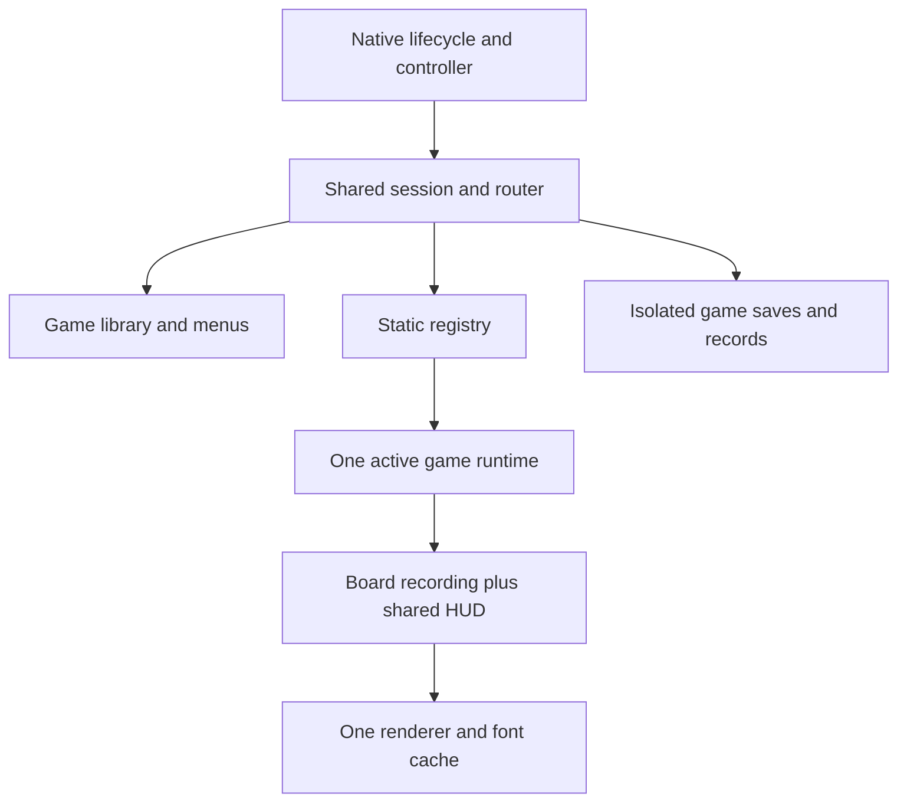

# M Arcade architecture

Available on `main` for ID7. One native OAP app, `iabadia_m_arcade`, contains all six games. Standalone sources are frozen legacy references and excluded from Store/release discovery; ID8 integration stays on its separate branch. Local, linked-package and mocked native checks are distinct from parked-car validation.

## Source map

```text
apps/iabadia_m_arcade/
  src/
    app.js                    one OAP lifecycle, renderer and native host stack
    core/
      registry.js             static game definitions and loaders
      session.js              routes, menus, initials, clock and active runtime
      carousel.js             looping UI selection and retargetable easing
      runtime.js              common adapter mechanics and snapshot contract
      input.js                one normalized CCU input source
      saves.js                bounded, atomic per-game saves and migrations
      scores.js               ranking policies, run identity and stable ties
    ui/
      draw.js                 carousel, HUD, common menus and name entry
      theme.js                shared colour and layout tokens
      icons.js / png.js       cached, bounded RGBA icon loading
    games/<id>/
      definition.js           metadata, controls, modes, ranking and loader
      model.js                pure game rules
      runtime.js              model adapter and timing/input effects
      board.js                board-only drawing; no menus or advancement
    kit/                      one renderer client, drawing kit and font set
  package-src/                generated flat modules for the existing unit linker
  iabadia_m_arcade@0.1.2/      native resources, licenses and packaged icons
  assets/                     canonical launcher/game PNGs
  tools/                      build, preview, tests and offline import
```

Edit `src/`, then run the build to refresh `package-src/`. Generated modules are committed so Store branch installs can use the existing on-unit linker directly. Both trees are checked by tests, including launching an actually linked bundle against SDK test doubles. Only M Arcade has an active `release.json` and Store manifest entry. Standalone metadata is retained as `legacy-release.json`; see [legacy policy](../LEGACY_GAMES.md). The source package includes the flat modules and native resources once; it excludes canonical source copies, tools, SDK code, tests, screenshots and user saves.



## Game boundary

[The contract](game-contract.d.ts) describes the implemented API. A definition supplies identity, icon, controls, modes, timing cap, ranking policy and a literal loader. The adapter supplies input/update effects, phase, board recording, HUD/actions, eligible score, state validation/migration and disposal. Continuation and action toolbars are module capabilities; the shell does not branch on game IDs.

The model owns rules. The adapter owns gameplay timing and transient animation. The shared session owns navigation, storage, name entry and score submission. Models/adapters do not import the SDK or filesystem. `render()` does not advance simulation or write saves. The shell updates once before rendering, with a monotonic game clock that excludes paused time and an injected random source.

2048 exposes tile movement/merge animation. Minesweeper exposes its Reveal/Flag/Menu toolbar. Snake preserves pending turns and step timing; Tetris preserves gravity/lock countdowns. Invaders and Breakout retain their bounded physics substeps and full projectile/ball state. Transient frame caches, trails and feedback are excluded from saves.

Returning to the library checkpoints and disposes the active runtime. Selecting it again reconstructs a paused run. No inactive game owns timers, controller subscriptions or renderer connections. A new game or mode replacement gets a new run ID and preserves every existing record.

## Controls and native navigation

| Route | Wheel | Tilt | Center | Native Back |
| --- | --- | --- | --- | --- |
| Library | Browse games | Previous/next game | Open selected game | Exit |
| Gameplay | Game mapping | Game mapping | Pause, or game-defined action | Checkpoint and return to library |
| Pause | Select option | Up/down select | Confirm | Resume |
| Detail | Route-specific | Route-specific | Confirm | Return to menu |
| Initials | Change letter | Left/right cursor, up/down letter | Next letter; third saves | Cancel draft to parent |

Four native hosts represent **Library -> Game -> Menu -> Detail**. Back is handled through native focus/depth changes, not an invented raw Back event. Navigation waits while a popup owns focus. Focus loss, renderer loss and app hiding pause the game and release controller ownership; reconnect never resumes timed play automatically. Input baselines reset across routes/focus so a held press cannot confirm twice or move the board behind a menu.

The shared menu includes Resume/Keep playing where supported, New game, Difficulty where available, Records, How to play, Back to Arcade and Exit M Arcade. The library remembers its selection and marks saved games. Its looping carousel uses an independent UI clock, cubic easing, depth/scale changes and continuous retargeting during rapid wheel turns. Rendering only samples the animation; the shared scheduler requests frames until it settles. Launch selects the target immediately, and hiding cancels pending UI motion.

## Persistence and score policies

```text
data/m-arcade/shell.json
data/m-arcade/games/<game-id>.json
```

Every game envelope contains an envelope/state version, stable game/mode ID, run ID, model/adapter state, all records and an optional initials draft. State and records are committed together. Saves use a bounded JSON payload, restrictive permissions, temp-file/fsync/rename writes and a last-known-good backup. One game's invalid data cannot replace another game's save. Future state upgrades call the module migration hook, validate the result and retain the pre-upgrade backup before committing.

Accepted inputs checkpoint immediately; timed updates coalesce checkpoints with a two-second maximum interval during play. Pause, completion, transitions and shutdown checkpoint too. Saves never advance time. A failed write keeps the current runtime/name draft available for retry and blocks destructive app-controlled transitions. Native Back can already have changed focus: a failed return retains the paused runtime behind a blocked library until center retries successfully. Process termination can still lose progress since the latest successful checkpoint.

| Game | Ranking |
| --- | --- |
| 2048 | Points descending, top five; improved submissions update the same run |
| Minesweeper | Winning milliseconds ascending, one record per difficulty |
| Snake / Tetris / Invaders / Breakout | Points descending, one record per difficulty |

New entries use three uppercase letters. Ties preserve the incumbent. Replaying the same named submission is harmless. Imported historical entries without a name display `---`; their names are never fabricated. A qualifying unfinished current run can claim its imported unnamed entry.

## Build and size

The existing linker identifies modules by basename and recognizes single-quoted static `require()` calls. `tools/build.js` scans canonical source, emits unique flat names, rewrites static dependencies to those aliases and generates `mgu-app.json`. It preserves SDK/Node imports and source/license comments, rejects unresolved or dynamic imports and detects filename collisions. CommonJS cycles follow the existing linker's caching behavior; game modules should keep their dependency graph directed toward the common runtime/kit.

One shared font set replaces six copies (the unused 103px title atlas is omitted; 58px remains for the 2048 merge pop), one kit/client replaces six transports, and library icons are decoded once and reused across frames/reconnects. Six 140px RGBA icons occupy about 459 KiB before renderer copies. Keep the 512 KiB compressed / 1 MiB unpacked source budgets; see [measured sizes](../APP_SIZES.md). Package size is not installed memory or SDK-linked disk usage.

## Importing existing saves

The new app has a different UID/data directory. It cannot automatically read old apps' private data. `tools/import_saves.js` converts **explicitly exported** JSON files into a separate M Arcade data directory. It validates every source before writing, keeps source exports unchanged, skips existing destination saves and is repeatable. Tests cover all six formats, 2048 top-five/run/draft migration and other games' per-mode records.

See [the import instructions](../../apps/iabadia_m_arcade/README.md#import-existing-saves). Exporting from the car and transferring the generated files back still requires an authorized deployment/file-transfer mechanism; no unverified Store API or automatic cross-UID access is assumed. Keep old apps/saves until the transfer and M Arcade persistence have been checked on the car. Do not automatically uninstall them.

## Adding a game

1. Add `src/games/<id>/{model,runtime,board,definition}.js`. Extend the common runtime where useful; keep filesystem/native/UI routes out of the module.
2. Declare modes, controls, timing cap, ranking, icon and a static `load()`; add its definition to `core/registry.js`.
3. Supply a bounded, validated snapshot and explicit migrations for any later schema bump. Put gameplay-essential countdowns/queues in adapter `extra()`.
4. Add a 140px icon using the [M Arcade Icons skill](../../.agents/skills/m-arcade-icons/SKILL.md), rule/contract tests and help text. No separate native app, menu, font copy or transport is needed.
5. Run `npm test`, `npm run build`, `npm run size` and the reproducibility check after committing. Review the desktop preview and validate native behavior before release.

The six standalone implementations are retained as frozen snapshots; new game development belongs only in the modular M Arcade source tree. Standalone app sources remain unchanged except for legacy documentation and release-registration retirement. ID8 work is intentionally separate.
